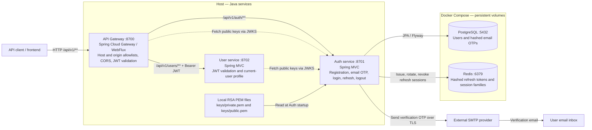
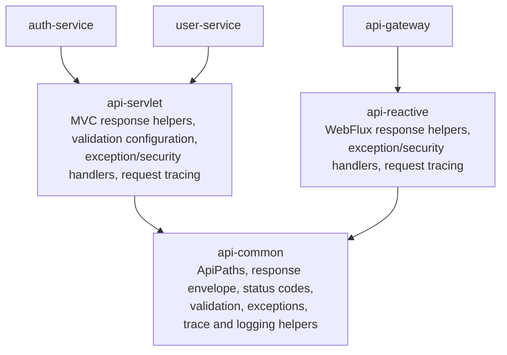

# Hybrid Auth Microservices Lab

A runnable *learning/reference implementation* of JWT access tokens, opaque rotating refresh tokens, Redis-backed refresh sessions, PostgreSQL users, and a JWT-validating Spring Cloud Gateway. No Docker Desktop required; Docker CLI with a working daemon is sufficient.

API response schema, validation rules, error codes, Gateway allowlists, and shared-module usage: [API contract](docs/API.md).

Source packages and folder responsibilities: [Project structure](docs/PROJECT_STRUCTURE.md).

## Current architecture

The local setup runs three Java services on the host and two data stores in Docker Compose. Clients call the Gateway at port `8700`; Auth and User bind to `127.0.0.1` by default. SMTP is an external dependency configured through `.env`.



Solid arrows show request/data connections; dotted arrows show public-key retrieval. Gateway and User use Auth's `/.well-known/jwks.json` endpoint to validate JWTs locally. Auth validates JWTs with its configured RSA public key. All three validate issuer and the `hybrid-api` audience. User currently builds `/api/v1/users/me` from the JWT subject and roles; it has no database dependency.

| Component | Responsibility |
| --- | --- |
| `api-gateway` | Enforce host/origin allowlists and CORS, validate JWTs for protected requests, and forward versioned routes to Auth or User. The six Auth POST endpoints are public; their handlers validate credentials, OTPs, or refresh tokens as appropriate. |
| `auth-service` | Store users and BCrypt password/OTP hashes in PostgreSQL, send verification email synchronously, sign RS256 access JWTs, and manage refresh sessions in Redis. Flyway maintains the database schema. |
| `user-service` | Independently validate access JWTs and return the current user's ID and roles. |
| PostgreSQL | Persist user identity, verification state, OTP hashes, expiry, cooldown, and attempt counts in the `authdb` database. |
| Redis | Store SHA-256 refresh-token hashes with user/role/family metadata and family membership, with seven-day TTLs. |

### Authentication flow

1. **Register:** `POST /api/v1/auth/register` creates an unverified user and sends a six-digit email OTP. The response contains registration data, without tokens. Failed email delivery returns HTTP 503 and rolls back registration.
2. **Verify:** `POST /api/v1/auth/verify-email` verifies the OTP against its stored hash and marks the email verified. Codes expire after five minutes and allow five attempts; `/api/v1/auth/resend-otp` replaces the code after a 60-second cooldown.
3. **Login:** `POST /api/v1/auth/login` checks the BCrypt password and email verification state, then returns a 15-minute RS256 access JWT and an opaque refresh token. The refresh session is stored in Redis for seven days.
4. **Access a protected API:** send `Authorization: Bearer <accessToken>` to `GET /api/v1/users/me`. Gateway validates the token before forwarding it; User validates it again and reads its claims. This request does not query PostgreSQL or Redis.
5. **Refresh or logout:** `POST /api/v1/auth/refresh` consumes the current refresh token, reloads the user from PostgreSQL, and issues a new token pair in the same session family. `POST /api/v1/auth/logout` uses the current refresh token to revoke that family's refresh sessions. Existing access JWTs remain valid until expiry.

### Shared modules

Arrows below mean “depends on.” These modules are libraries packaged with the services, not separate running services.



Servlet and reactive adapters auto-configure for their respective web stacks. Business responses share the same JSON envelope and `X-Request-Id` correlation header. JWKS and Actuator retain their standard response formats.

Business endpoints use `/api/v1` in both Gateway routes and service mappings. Java controllers and security matchers share roots in [`ApiPaths`](api-common/src/main/java/dev/kaidev/common/api/ApiPaths.java); Gateway routes are declared in [`application.yml`](api-gateway/src/main/resources/application.yml). Future `/api/v2` controllers and routes can coexist with v1; see [API versions](docs/API.md#api-versions).

## Prerequisites
- Docker Engine / Colima / OrbStack with Docker Compose v2
- OpenSSL, JDK 25, Maven
- VS Code with the recommended Java Extension Pack (see `.vscode/extensions.json`)

## Local run/debug with VS Code
Docker runs only PostgreSQL and Redis by default. Auth, User, and Gateway run on the host through VS Code.

1. Open this repository root in VS Code and install the recommended Java extensions.
2. Run **Developer: Reload Window** after changing the Java settings and let Maven import finish.
3. Open **Run and Debug**, choose **All Services (Local)**, then press **F5** to debug or **Ctrl+F5** to run without debugging. The prepare task reuses existing JWT keys (or creates them when missing), starts both databases, and waits until they are healthy.
4. Set breakpoints in any service, for example `ProfileController.me`, and send requests through `http://localhost:8700`.

| Component | Local address |
| --- | --- |
| Gateway | `http://localhost:8700` |
| Auth service | `http://localhost:8701` |
| User service | `http://localhost:8702` |
| PostgreSQL | `127.0.0.1:5432`, database `authdb`, user `auth` |
| Redis | `127.0.0.1:6379` |

The default local database password is `authdev`. The local `.env` is created from `.env.example`; update `DB_PASSWORD` there before first database startup. Compose and the Auth launch configuration use the same file. For an existing PostgreSQL volume, changing this variable does not change the stored database password.

To launch services individually, first run **Tasks: Run Task → local: prepare**, then choose **Auth Service**, **User Service**, or **Gateway** in Run and Debug. Wait for all services to finish startup before sending API requests. Stopping **All Services (Local)** stops all three Java processes; the databases stay running. Use **Tasks: Run Task → local: databases stop** to stop them without deleting data.

The workspace selects the JDK 25 already installed on this Mac at `/opt/homebrew/opt/openjdk/libexec/openjdk.jdk/Contents/Home` for Java tooling and new integrated terminals. On another machine, update the JDK paths in `.vscode/settings.json`. If an individual service or VS Code cannot resolve `dev.kaidev.common`, run **Tasks: Run Task → maven: install shared modules** to install the parent POM and shared libraries into Maven local. After package moves, close tabs pointing to the old paths and reopen files from Explorer. If Java diagnostics remain stale, run **Java: Clean Java Language Server Workspace** and reload.

Run all services from a terminal:
```bash
./run-services.sh
```

The script creates `.env` from `.env.example` if missing, reuses existing JWT keys, starts PostgreSQL and Redis with Docker Compose, runs `mvn verify`, then launches all three Java services. It waits for each health endpoint before continuing. Logs are written to `logs/`. Press **Ctrl+C** to stop all Java services; databases keep running. Stop them with `docker compose stop`.

Use JDK 25 (`JAVA_HOME`); on macOS the script also detects the Homebrew JDK used by this workspace. Docker Compose contains only PostgreSQL and Redis.

The tasks **local: prepare**, **local: databases up**, **local: databases stop**, and **maven: verify** are also available from **Tasks: Run Task**. **Cmd+Shift+B** runs Maven verification on macOS.

## Email verification configuration
Fill in the keys in `.env` (SMTP credentials are intentionally left empty):
```dotenv
SMTP_HOST=
SMTP_PORT=587
SMTP_SECURE=false
SMTP_USER=
SMTP_PASS=
EMAIL_FROM=""
```
`SMTP_SECURE=false` uses STARTTLS (normally port 587); `true` uses implicit TLS (normally port 465). `EMAIL_FROM` accepts `Team Name <sender@example.com>`. Restart the services after editing `.env`. The shell runner loads these keys; the VS Code Auth launch also reads `.env`. Direct Maven/Java launches need these variables exported.

Registration sends a six-digit email OTP and returns `emailVerified: false`, without tokens. Login and refresh require a verified email. Existing accounts must request an OTP with `/api/v1/auth/resend-otp` before logging in again; previously issued access tokens remain valid until expiry. OTPs expire after five minutes, allow five attempts, and are stored as hashes. Resending requires a 60-second wait and replaces the previous code. Missing SMTP configuration or mail delivery failure returns HTTP 503; failed registration is rolled back so it can be retried.

## Functional test
Business APIs use the `/api/v1` prefix. See [API versions](docs/API.md#api-versions) for adding future versions.
Registration passwords must contain at least 12 characters and at most 72 UTF-8 bytes. Validation errors return HTTP 400 with field messages in the `errors` array; all business responses use the shared [API contract](docs/API.md).
```bash
curl -i -X POST http://localhost:8700/api/v1/auth/register -H 'Content-Type: application/json' -d '{"email":"test@example.com","password":"StrongPassword123!"}'
# Read the OTP from your email and verify before logging in:
curl -i -X POST http://localhost:8700/api/v1/auth/verify-email -H 'Content-Type: application/json' -d '{"email":"test@example.com","otp":"123456"}'
# Optional: request a new code after 60 seconds:
# curl -i -X POST http://localhost:8700/api/v1/auth/resend-otp -H 'Content-Type: application/json' -d '{"email":"test@example.com"}'
curl -s -X POST http://localhost:8700/api/v1/auth/login -H 'Content-Type: application/json' -d '{"email":"test@example.com","password":"StrongPassword123!"}'
```
Copy `data.accessToken` from the login JSON, then call:
```bash
curl http://localhost:8700/api/v1/users/me -H 'Authorization: Bearer YOUR_ACCESS_TOKEN'
```
Refresh via `POST /api/v1/auth/refresh` with `{"refreshToken":"..."}`; call `POST /api/v1/auth/logout` with the *current* refresh token. Login / refresh responses return tokens in JSON for API debugging; do not store these in localStorage in a browser app.

## Scope / security limitations
- Lab returns refresh tokens in JSON. For production browser deployment implement a BFF or HttpOnly Secure SameSite cookie, CSRF protection for cookie authentication, and a tested reverse proxy/TLS termination.
- The synchronized refresh rotation protects a single Auth instance only. For multiple instances use one atomic Redis Lua script for consume-and-rotate plus refresh-token reuse detection and family revocation.
- `logout` revokes future refresh only; previously issued access JWTs remain valid until expiry (15 minutes). Critical revocation needs a short-lived access TTL or introspection/denylist.
- No password reset, login lockout/rate limiting, audit pipeline, distributed tracing, dynamic key rotation, or secret manager yet.
- Demo credentials and keys are for local development only. Private keys are excluded from git; the local Auth process reads RSA PEM files from `keys/` by default.
- Backend services should not be publicly exposed; retain private network access and service-level JWT verification.
