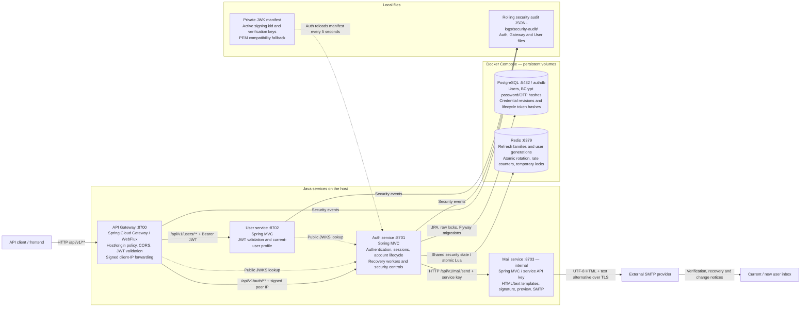
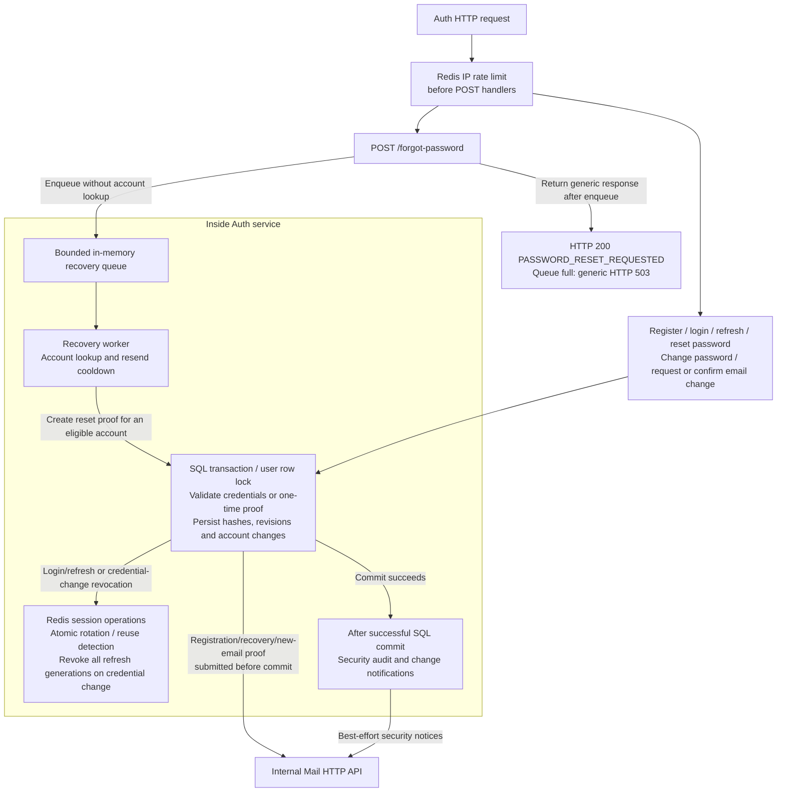
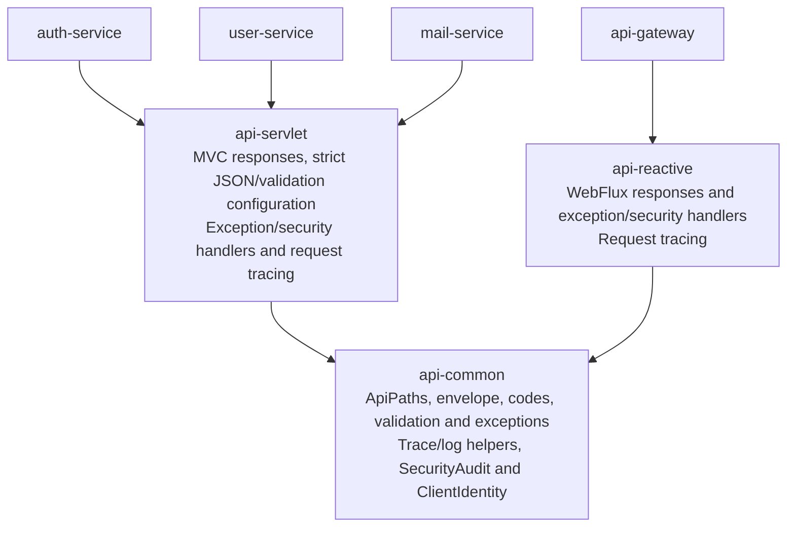

# Hybrid Auth Microservices Lab

A runnable *learning/reference implementation* of JWT access tokens, opaque rotating refresh tokens, Redis-backed refresh sessions, PostgreSQL users, and a JWT-validating Spring Cloud Gateway. No Docker Desktop required; Docker CLI with a working daemon is sufficient.

API response schema, validation rules, error codes, Gateway allowlists, and shared-module usage: [API contract](docs/API.md).

P1 account recovery, password/email changes, and signed email templates: [Account lifecycle](docs/ACCOUNT_LIFECYCLE_P1.md).

P0 controls, Redis session lifecycle, rate limits, lockout, key rotation, and audit operations: [Security hardening](docs/SECURITY_P0.md).

Mail API, HTML templates, and integration guide: [Mail service](docs/MAIL_SERVICE.md).

Source packages and folder responsibilities: [Project structure](docs/PROJECT_STRUCTURE.md).

## Current architecture

The system has four independently running Java services. The local runner starts them on the host; Docker Compose runs PostgreSQL and Redis with persistent volumes. Gateway is the client entry point. Auth, User, and Mail bind to loopback by default, and Mail has no public Gateway route.



Solid arrows show request, data, or log writes; dotted arrows show key retrieval/reload. Gateway and User fetch only public keys from Auth's `/.well-known/jwks.json`, then validate access JWTs locally. Auth signs with the active RSA key and validates with its public key ring. All three check issuer and the `hybrid-api` audience. Access JWTs use RS256 and a 15-minute lifetime; key rotation retains overlapping verification keys.

User currently builds `/api/v1/users/me` from the JWT subject and roles. It has no PostgreSQL or Redis connection, and that request does not call Auth to introspect a session. Mail also has no database: templates are trusted HTML/text resources registered in configuration and loaded at startup.

| Component | Responsibility and owned state |
| --- | --- |
| `api-gateway` | Route versioned APIs; enforce host/origin allowlists and CORS; validate JWTs on protected routes; replace caller identity headers with an HMAC proof of the TCP peer IP. The shared `AUTH_PROXY_KEY` lets Auth verify that proof before using the forwarded rate-limit identity. |
| `auth-service` | Own users, registration OTPs, lifecycle proofs, credentials and session policy. Apply shared IP limits/temporary lockout; issue JWTs; atomically rotate/revoke refresh families; coordinate password/email changes and Mail calls. |
| `user-service` | Independently validate JWTs and return the authenticated user's ID and roles. |
| `mail-service` | Own SMTP credentials, sender address, eight HTML/text templates, required variables, managed `MAIL_SIGNATURE`, template preview and synchronous email submission. Internal requests require `MAIL_SERVICE_API_KEY`. |
| PostgreSQL | Persist users, BCrypt password/OTP hashes, verification state, credential revisions, cooldowns and SHA-256 hashes of reset/email-change proofs. Flyway manages migrations through `V3__account_lifecycle.sql`. |
| Redis | Persist hashed refresh-token records, current/revoked family state, user session generations, shared IP counters and temporary login locks. Refresh families have a seven-day absolute expiry; Lua scripts serialize security-state changes across Auth instances. |
| Key manifest and audit files | Supply reloadable signing/verification keys and local rolling security event storage. Audit payloads exclude passwords, OTPs, tokens, emails and private keys; these files are not a centralized immutable audit store. |

### Inside Auth: recovery and account changes

The recovery queue and workers belong to Auth's process; they are not another service or a Redis-backed job queue. The default executor has two workers and a capacity of 100 pending requests.



The diagram shows component connections, not one mandatory sequence for every endpoint. Proof mail is sent before committing its SQL transaction, so delivery failure rolls back the new proof and cooldown. Completed password/email changes send notifications after commit; notification failure is audited and does not undo the account change. Mail's SMTP submission remains synchronous, including when a recovery worker calls it.

User row locks serialize login/refresh issuance with password/email mutations. Lifecycle tokens are random, single-use opaque values with a 15-minute TTL, stored only as hashes and bound to a purpose and credential revision. A password reset/change or confirmed email change invalidates pending lifecycle proofs and revokes every refresh session. The in-memory recovery queue and after-commit notices are not a durable outbox or retry system.

### Authentication and lifecycle flows

1. **Register and verify:** `/api/v1/auth/register` stores an unverified user and requests the `email-verification` template. The hashed six-digit OTP expires after five minutes and allows five attempts. `/verify-email` verifies it; `/resend-otp` and its `/resend-verification` alias share the existing 60-second cooldown. Registration returns no tokens.
2. **Login and protected access:** `/login` checks password, verification and temporary lockout, then issues an access JWT and opaque refresh token. Gateway and User independently validate the JWT for `/api/v1/users/me`; no session lookup is added to that GET request.
3. **Refresh and logout:** `/refresh` rotates the current refresh token atomically. Reusing a consumed token revokes its entire family. `/logout` revokes a family; protected `/logout-all` advances the authenticated user's generation to revoke every existing refresh family.
4. **Forgot and reset password:** `/forgot-password` enqueues work and returns a generic response. The worker sends `password-reset` for an eligible account. `/reset-password` consumes the proof, changes the password, clears temporary login lockout and revokes refresh sessions; `password-changed` follows after commit.
5. **Change password or email:** protected `/change-password` and `/change-email` require the current password. Email stays unchanged until `/confirm-email-change` consumes the new inbox's proof. Mail sends request/change notifications to the appropriate old/new inboxes, each with the managed signature.

All short paths in this list are relative to `/api/v1/auth`. Existing access JWTs remain valid until expiry plus validator clock skew after logout or credential changes; immediate access-token revocation would require an additional state check. Operational details: [P0 security](docs/SECURITY_P0.md), [P1 lifecycle](docs/ACCOUNT_LIFECYCLE_P1.md), and [Mail service](docs/MAIL_SERVICE.md).

### Shared modules

Arrows below mean “depends on.” These modules are libraries packaged with the services, not separate running services.



Servlet and reactive adapters auto-configure for their respective web stacks. Business responses share the same JSON envelope and `X-Request-Id` correlation header. JWKS and Actuator retain their standard response formats. Auth propagates the trace ID to recovery workers and Mail calls.

Business endpoints use `/api/v1` in both Gateway routes and service mappings. Java controllers and security matchers share roots in [`ApiPaths`](api-common/src/main/java/dev/kaidev/common/api/ApiPaths.java); Gateway routes are declared in [`application.yml`](api-gateway/src/main/resources/application.yml). Future `/api/v2` controllers and routes can coexist with v1; see [API versions](docs/API.md#api-versions).

## Prerequisites
- Docker Engine / Colima / OrbStack with Docker Compose v2
- OpenSSL, JDK 25, Maven, Python 3
- VS Code with the recommended Java Extension Pack (see `.vscode/extensions.json`)

## Local run/debug with VS Code
Docker runs only PostgreSQL and Redis by default. Mail, Auth, User, and Gateway run on the host through VS Code.

1. Open this repository root in VS Code and install the recommended Java extensions.
2. Run **Developer: Reload Window** after changing the Java settings and let Maven import finish.
3. Open **Run and Debug**, choose **All Services (Local)**, then press **F5** to debug or **Ctrl+F5** to run without debugging. The prepare task reuses existing JWT keys (or creates them when missing), starts both databases, and waits until they are healthy.
4. Set breakpoints in any service, for example `ProfileController.me`, and send requests through `http://localhost:8700`.

| Component | Local address |
| --- | --- |
| Gateway | `http://localhost:8700` |
| Auth service | `http://localhost:8701` |
| User service | `http://localhost:8702` |
| Mail service (internal) | `http://127.0.0.1:8703` |
| PostgreSQL | `127.0.0.1:5432`, database `authdb`, user `auth` |
| Redis | `127.0.0.1:6379` |

The default local database password is `authdev`. The local `.env` is created from `.env.example`; update `DB_PASSWORD` there before first database startup. Compose and the Auth launch configuration use the same file. For an existing PostgreSQL volume, changing this variable does not change the stored database password.

To launch services individually, first run **Tasks: Run Task → local: prepare**, then choose **Auth Service**, **User Service**, **Gateway**, or **Mail Service** in Run and Debug. Wait for all services to finish startup before sending API requests. Stopping **All Services (Local)** stops all four Java processes; the databases stay running. Use **Tasks: Run Task → local: databases stop** to stop them without deleting data.

The workspace selects the JDK 25 already installed on this Mac at `/opt/homebrew/opt/openjdk/libexec/openjdk.jdk/Contents/Home` for Java tooling and new integrated terminals. On another machine, update the JDK paths in `.vscode/settings.json`. If an individual service or VS Code cannot resolve `dev.kaidev.common`, run **Tasks: Run Task → maven: install shared modules** to install the parent POM and shared libraries into Maven local. After package moves, close tabs pointing to the old paths and reopen files from Explorer. If Java diagnostics remain stale, run **Java: Clean Java Language Server Workspace** and reload.

Run all services from a terminal:
```bash
./run-services.sh
```

The script runs `prepare-env.sh` to create `.env` if missing and generate `MAIL_SERVICE_API_KEY` and `AUTH_PROXY_KEY` when empty, runs `prepare-jwt.sh` to initialize the reloadable manifest from existing JWT keys, starts PostgreSQL and Redis with Docker Compose, runs `mvn verify`, then launches Mail first, followed by Auth, User, and Gateway. It waits for each health endpoint before continuing. Logs are written to `logs/`. Press **Ctrl+C** to stop all Java services; databases keep running. Stop them with `docker compose stop`.

Use JDK 25 (`JAVA_HOME`); on macOS the script also detects the Homebrew JDK used by this workspace. Docker Compose contains only PostgreSQL and Redis.

The tasks **local: prepare**, **local: databases up**, **local: databases stop**, and **maven: verify** are also available from **Tasks: Run Task**. **Cmd+Shift+B** runs Maven verification on macOS.

## Email verification configuration
Mail owns the SMTP settings. Auth calls it using `MAIL_SERVICE_URL` and the same `MAIL_SERVICE_API_KEY`. Both `./run-services.sh` and the VS Code prepare task generate this key in `.env` when missing; for manual launches run `bash ./prepare-env.sh` first. SMTP credentials are intentionally left empty:
```dotenv
MAIL_SERVICE_URL=http://127.0.0.1:8703
MAIL_SERVICE_PORT=8703
# MAIL_SERVICE_API_KEY is generated in .env by prepare-env.sh
SMTP_HOST=
SMTP_PORT=587
SMTP_SECURE=false
SMTP_USER=
SMTP_PASS=
EMAIL_FROM=""
```
`SMTP_SECURE=false` uses STARTTLS (normally port 587); `true` uses implicit TLS (normally port 465). `EMAIL_FROM` accepts `Team Name <sender@example.com>`. Restart the services after editing `.env`. The shell runner loads these keys; the VS Code Auth and Mail launches also read `.env`. SMTP is configured only in Mail. Direct Maven/Java launches need these variables exported.

Mail includes eight signed HTML/text templates for verification, welcome, password recovery/change, and email changes. Configure their shared footer using `MAIL_SIGNATURE` (default: `Hybrid Auth Security Team`). See [Mail service](docs/MAIL_SERVICE.md) to list, preview, send, or configure another template. Template changes require restarting Mail. `welcome` is available to callers but is not sent automatically during registration.

Registration sends a six-digit email OTP and returns `emailVerified: false`, without tokens. Login and refresh require a verified email. Existing accounts must request an OTP with `/api/v1/auth/resend-otp` before logging in again; previously issued access tokens remain valid until expiry. OTPs expire after five minutes, allow five attempts, and are stored as hashes. Resending requires a 60-second wait and replaces the previous code. Missing SMTP configuration or mail delivery failure returns HTTP 503; failed registration is rolled back so it can be retried.

## Functional test
Business APIs use the `/api/v1` prefix. See [API versions](docs/API.md#api-versions) for adding future versions.
Registration passwords must contain at least 12 characters and at most 72 UTF-8 bytes. Validation errors return HTTP 400 with field messages in the `errors` array; all business responses use the shared [API contract](docs/API.md).
```bash
curl -i -X POST http://localhost:8700/api/v1/auth/register -H 'Content-Type: application/json' -d '{"email":"test@example.com","password":"StrongPassword123!"}'
# Read the OTP from your email and verify before logging in:
curl -i -X POST http://localhost:8700/api/v1/auth/verify-email -H 'Content-Type: application/json' -d '{"email":"test@example.com","otp":"123456"}'
# Optional: request a new code after 60 seconds:
# curl -i -X POST http://localhost:8700/api/v1/auth/resend-otp -H 'Content-Type: application/json' -d '{"email":"test@example.com"}'
curl -s -X POST http://localhost:8700/api/v1/auth/login -H 'Content-Type: application/json' -d '{"email":"test@example.com","password":"StrongPassword123!"}'
```
Copy `data.accessToken` from the login JSON, then call:
```bash
curl http://localhost:8700/api/v1/users/me -H 'Authorization: Bearer YOUR_ACCESS_TOKEN'
```
Refresh via `POST /api/v1/auth/refresh` with `{"refreshToken":"..."}`; call `POST /api/v1/auth/logout` with a refresh token to revoke its family. Use `POST /api/v1/auth/logout-all` with a Bearer access JWT to revoke every device's refresh sessions. Login / refresh responses return tokens in JSON for API debugging; do not store these in localStorage in a browser app.

## Account lifecycle (P1)

Email verification/resend reuse the existing OTP implementation; `/api/v1/auth/resend-verification` is an alias for `/resend-otp`. New endpoints are `/forgot-password`, `/reset-password`, `/change-password`, `/change-email`, and `/confirm-email-change` under `/api/v1/auth`.

Forgot-password uses a bounded in-memory worker queue and returns a generic response without waiting for account lookup or mail delivery. Reset and email-change proofs are single-use opaque tokens, stored only as hashes with a 15-minute TTL. Password/email changes require a Bearer JWT and the current password; the new email becomes active only after its inbox confirms the change. Completed changes revoke all refresh sessions and send signed security notifications. See [P1 account lifecycle](docs/ACCOUNT_LIFECYCLE_P1.md) for request fields, failure behavior, and templates.

## Scope / security limitations
- Lab returns refresh tokens in JSON. For production browser deployment implement a BFF or HttpOnly Secure SameSite cookie, CSRF protection for cookie authentication, and a tested reverse proxy/TLS termination.
- Refresh operations and abuse controls use atomic Redis scripts across Auth instances. Security-state operations fail closed when Redis is unavailable. Durable Redis state and consistent recovery remain deployment requirements; see [P0 operations](docs/SECURITY_P0.md).
- `logout` and `logout-all` revoke future refresh only; previously issued access JWTs remain valid until expiry (15 minutes). Critical revocation needs a short-lived access TTL or introspection/denylist.
- Mail service delivery is synchronous, without a durable queue, outbox, automatic retries, or persistent delivery history. Auth uses a bounded in-memory queue for forgot-password requests and best-effort after-commit change notifications. An SMTP success means provider acceptance; it does not confirm inbox delivery. A timeout after provider acceptance can leave the caller uncertain whether mail was sent.
- No MFA, centralized immutable audit store, distributed tracing, or secret-manager integration yet. P0 provides shared rate limiting/temporary lockout, file-based JWT key rotation, and local rolling JSON audit logs.
- Demo credentials and keys are for local development only. Private keys are excluded from git; local preparation imports the existing RSA key into a private, reloadable JWK manifest under `keys/`.
- Backend services should not be publicly exposed; retain private network access and service-level JWT verification.
