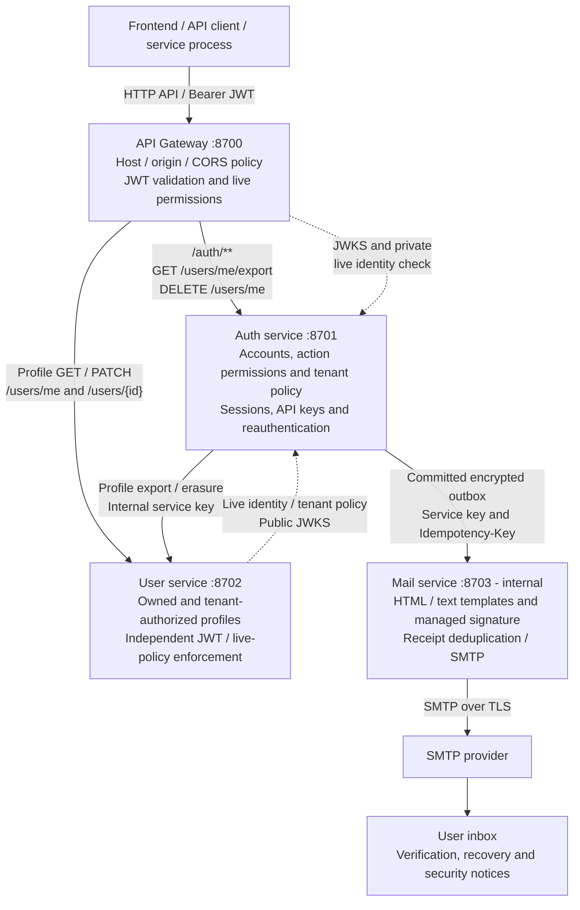
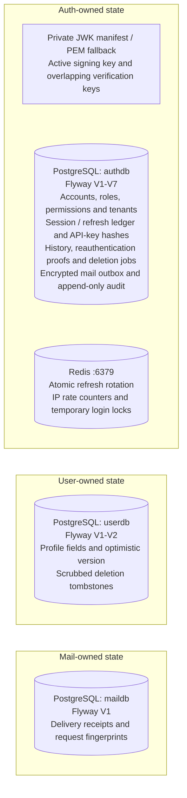
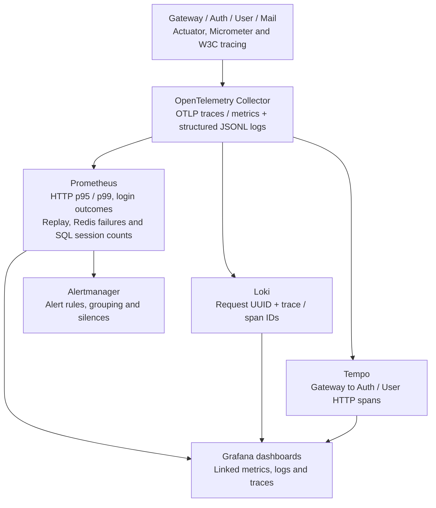
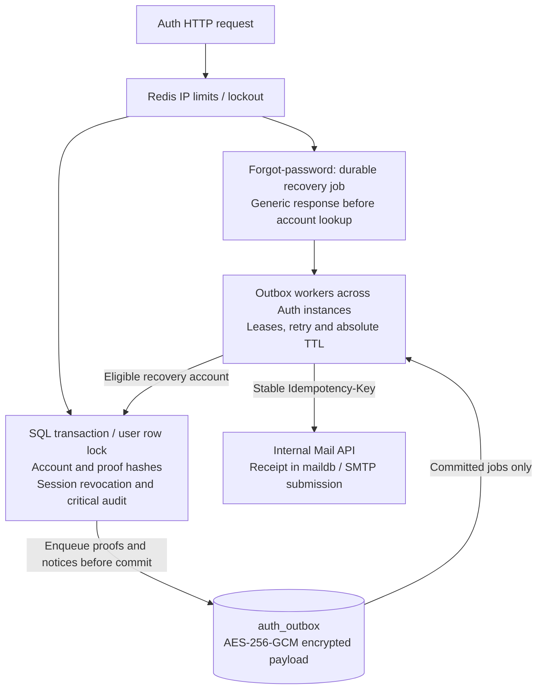
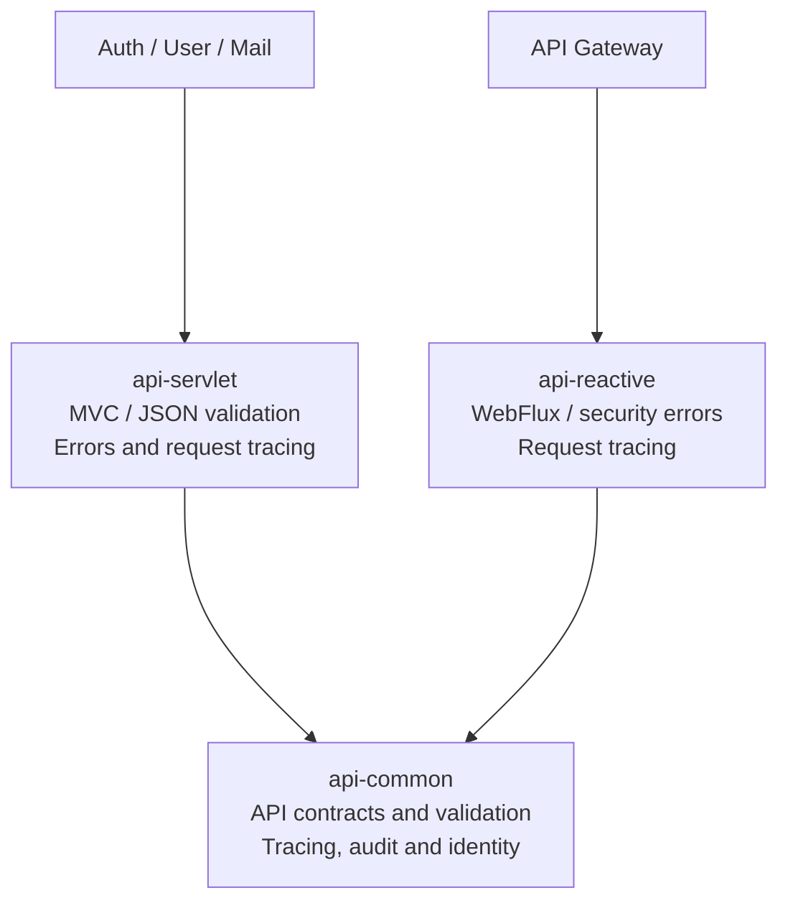

# Hybrid Auth Microservices Lab

A runnable *learning/reference implementation* of JWT access tokens, opaque rotating refresh tokens, SQL-backed session revocation, rotating Redis refresh records, separate identity/profile/mail PostgreSQL databases, and a JWT-validating Spring Cloud Gateway. No Docker Desktop required; Docker CLI with a working daemon is sufficient.

API response schema, validation rules, error codes, Gateway allowlists, and shared-module usage: [API contract](docs/API.md).

Reliability fixes and rollout: [Six hardening improvements](docs/HARDENING_RELIABILITY.md).

Account access extension: [Admin users, API keys, tenant policy, notifications, history, export and deletion](docs/ACCOUNT_ACCESS.md).

P6 timeouts, circuit breakers, safe retries, durable delivery, probes and failure drills: [Resilience and distributed systems](docs/RESILIENCE_P6.md).

P5 metrics, distributed tracing, correlated logs, dashboards and alerting: [Observability and monitoring](docs/OBSERVABILITY_P5.md).

P4 automated tests, Testcontainers, OpenAPI contracts, coverage and security CI: [Testing and security verification](docs/TESTING_P4.md).

P2 sessions, devices, RBAC, User-owned profiles and deactivation: [Session and identity management](docs/SESSION_IDENTITY_P2.md).

P1 account recovery, password/email changes, and signed email templates: [Account lifecycle](docs/ACCOUNT_LIFECYCLE_P1.md).

P0 controls, Redis session lifecycle, rate limits, lockout, key rotation, and audit operations: [Security hardening](docs/SECURITY_P0.md).

Mail API, HTML templates, and integration guide: [Mail service](docs/MAIL_SERVICE.md).

Source packages and folder responsibilities: [Project structure](docs/PROJECT_STRUCTURE.md).

## Current architecture

The system has four independently running Java services. The local runner starts them on the host; Docker Compose runs PostgreSQL and Redis with persistent volumes. Gateway is the client entry point. Auth, User, and Mail bind to loopback by default, and Mail has no public Gateway route.

The diagrams use a **top-to-bottom layout**. Public endpoint labels below omit the common `/api/v1` prefix.



Solid arrows show API or delivery requests; dotted arrows show public-key retrieval and private identity/authorization checks. Account export/deletion route to Auth before the general User route. Other profile requests route to User. Mail and `/internal/**` endpoints have no public Gateway route.

Gateway and User fetch only public keys from Auth's `/.well-known/jwks.json`, validate JWT signatures locally, then ask Auth for current account/session state and permissions. Cross-user profile access additionally checks explicit tenant membership at Auth. Auth signs with the active RSA key from its reloadable private manifest. All JWT consumers check issuer and the `hybrid-api` audience. Human access tokens last 15 minutes; scoped machine tokens last at most five minutes and never outlive their API key.

### Data ownership

Each group below belongs to one service. The three SQL databases share one local PostgreSQL instance on port 5432; runtime credentials remain isolated. Docker Compose persists PostgreSQL and Redis, while key files stay on the host.



SQL is authoritative for account state, session revocation and refresh replay history. Auth alone accesses Redis. Services exchange profile export/erasure and identity decisions through authenticated internal HTTP APIs, rather than reading another service's database. Auth reloads its key manifest every five seconds; Gateway and User receive only public keys.

### Observability and security audit



The optional local stack is defined in `compose.observability.yaml`; its ports bind to loopback. Grafana is on `:3001`. Enable exporters with `OBSERVABILITY_ENABLED=true` before starting the JVMs. See [P5 setup and verification](docs/OBSERVABILITY_P5.md). Alert delivery defaults to local UI until deployment receivers are configured.

The existing durable SQL audit and rolling security JSONL remain independent. The Python audit collector can still retain cursors, deduplicate incidents and expose `:8710/metrics`; Loki receives a separate allowlisted stream without audit actor/details or arbitrary framework debug output.

User owns `userdb` and persists profile fields by immutable Auth subject UUID. It never queries `authdb`; Auth never queries profile tables. User checks identity/session state through Auth HTTP, including when called directly. Auth alone accesses the security Redis state. Mail owns `maildb` for idempotency receipts. Its trusted HTML/text templates are version-controlled resources loaded at startup. Auth owns the encrypted durable mail outbox. Runtime database roles have DML access only and cannot connect across service databases.

| Component | Responsibility and owned state |
| --- | --- |
| `api-gateway` | Route versioned APIs; enforce host/origin allowlists and CORS; validate JWTs on protected routes; replace caller identity headers with an HMAC proof of the client IP resolved through explicitly trusted ingress proxies. The shared `AUTH_PROXY_KEY` verifies forwarded IPs; a distinct `IDENTITY_SERVICE_KEY` protects live authorization checks. |
| `auth-service` | Own accounts, action permissions, tenants, credentials, session policy, API keys, trusted devices and login history. Enforce administrative status and reauthentication; coordinate export/erasure through User and encrypted notification jobs through Mail. |
| `user-service` | Own profile fields/versioning and deletion tombstones in `userdb`. Enforce JWT, live permissions, ownership and tenant policy; expose protected internal profile export/erasure APIs. |
| `mail-service` | Own SMTP credentials, sender address, eleven HTML/text templates, required variables, managed `MAIL_SIGNATURE`, template preview, durable idempotency receipts and SMTP submission. Internal requests require `MAIL_SERVICE_API_KEY`. |
| PostgreSQL | Persist users, BCrypt password/OTP hashes, verification state, credential revisions, cooldowns and SHA-256 hashes of reset/email-change proofs. Auth runs Flyway V1-V7; User runs V1-V2 and Mail runs V1 in their independent databases. |
| Redis | Cache hashed refresh records and generations; enforce shared IP counters and temporary login locks. SQL is authoritative for session revocation and replay history. Refresh families have a seven-day absolute expiry; Lua scripts serialize security-state changes across Auth instances. |
| Key manifest and audit files | Supply reloadable signing/verification keys and local rolling security event storage. Audit payloads exclude passwords, OTPs, tokens, emails and private keys; critical mutations also write SQL audit records, while the collector merges service events and exposes metrics/alerts. |

### Inside Auth: recovery and account changes

Auth persists recovery requests and encrypted mail jobs in PostgreSQL. Workers across instances claim jobs with leases and row locks, retry transient failures, and reuse a stable delivery ID at Mail.



Account changes, proof hashes, revocation and queued notices commit together; enqueue failure rolls them back. SMTP delivery runs afterward and retries without undoing account changes. Mail receipts deduplicate successful matching submissions. SMTP acceptance followed by a crash before receipt commit can still produce duplicate mail; SMTP acceptance does not prove inbox delivery.

Lifecycle proofs remain random, single-use opaque values with a 15-minute TTL and hashed SQL storage. Only their temporary mail-job copy is encrypted for delivery and erased after completion/expiry. A reset/change invalidates pending proofs and SQL sessions. Redis loss cannot restore sessions revoked in SQL. See [rollout and operational verification](docs/HARDENING_RELIABILITY.md).

### Authentication and lifecycle flows

1. **Register and verify:** `/api/v1/auth/register` stores an unverified user and requests the `email-verification` template. The hashed six-digit OTP expires after five minutes and allows five attempts. `/verify-email` verifies it; `/resend-otp` and its `/resend-verification` alias share the existing 60-second cooldown. Registration returns no tokens.
2. **Login and protected access:** `/login` checks password, verification and temporary lockout, then issues an access JWT and opaque refresh token. Gateway and User independently validate the JWT for `/api/v1/users/me`, then both check current identity/permissions via Auth. User reads its own profile database.
3. **Refresh and logout:** `/refresh` rotates the current refresh token atomically. Reusing a consumed token revokes its entire family. `/logout` revokes a family; protected `/logout-all` advances the authenticated user's generation to revoke every existing refresh family.
4. **Forgot and reset password:** `/forgot-password` enqueues work and returns a generic response. The worker sends `password-reset` for an eligible account. `/reset-password` consumes the proof, changes the password, clears temporary login lockout and revokes refresh sessions; `password-changed` follows after commit.
5. **Change password or email:** protected `/change-password` and `/change-email` require the current password. Email stays unchanged until `/confirm-email-change` consumes the new inbox's proof. Mail sends request/change notifications to the appropriate old/new inboxes, each with the managed signature.

6. **Sessions and devices:** `GET /api/v1/auth/sessions` lists owned active families; DELETE revokes a specific family. Device endpoints group sessions by optional `X-Device-Id` and retain login/refresh observations in Auth SQL. Revoked sessions fail live identity checks, including for previously issued JWTs.
7. **Profiles and RBAC:** User owns `GET/PATCH /api/v1/users/me`; identity fields cannot be edited there. Auth owns role/permission definitions and administrator role-assignment endpoints. Current permissions are enforced at service boundaries and administrative controllers.
8. **Deactivate:** `/deactivate` requires the current password, disables the identity, invalidates lifecycle proofs and revokes sessions. The account's retained User profile is inaccessible through protected APIs afterward.
9. **Administrative status and tenant access:** `/users` supports pagination/filter/sort; `PATCH /users/{id}/status` enables, disables or suspends an account and invalidates credentials. Role grants and tenant membership govern access to another user's profile.
10. **Machine access and device security:** named API keys exchange for scoped short-lived JWTs. Auth checks live key/account generations, tracks authentication history and sends a notice on first device observation; trusted-device preferences never skip authentication.
11. **Export and erasure:** `/reauthenticate` verifies the password and issues a session-bound five-minute proof for `GET /api/v1/users/me/export`. `DELETE /api/v1/users/me` requires the password, revokes access immediately and starts a durable job that erases User profile data before scrubbing Auth data.

Short Auth paths in this list are relative to `/api/v1/auth`. JWT cryptographic expiry remains 15 minutes, but P2 live state checks reject revoked/deactivated/stale-credential tokens on subsequent requests. Requests already authorized in flight are not canceled across services. See [P2 operations](docs/SESSION_IDENTITY_P2.md). Operational details: [P0 security](docs/SECURITY_P0.md), [P1 lifecycle](docs/ACCOUNT_LIFECYCLE_P1.md), and [Mail service](docs/MAIL_SERVICE.md).

### Shared modules

Arrows below mean “depends on.” These modules are libraries packaged with the services, not separate running services.



Servlet and reactive adapters auto-configure for their respective web stacks. Business responses share the same JSON envelope and `X-Request-Id` correlation header. JWKS and Actuator retain their standard response formats. Auth propagates the trace ID to recovery workers and Mail calls.

Business endpoints use `/api/v1` in both Gateway routes and service mappings. Java controllers and security matchers share roots in [`ApiPaths`](api-common/src/main/java/dev/kaidev/common/api/ApiPaths.java); Gateway routes are declared in [`application.yml`](api-gateway/src/main/resources/application.yml). Future `/api/v2` controllers and routes can coexist with v1; see [API versions](docs/API.md#api-versions).

## Prerequisites
- Docker Engine / Colima / OrbStack with Docker Compose v2
- OpenSSL, JDK 25, Maven, Python 3
- VS Code with the recommended Java Extension Pack (see `.vscode/extensions.json`)

## Local run/debug with VS Code
Docker runs only PostgreSQL and Redis by default. Mail, Auth, User, and Gateway run on the host through VS Code.

1. Open this repository root in VS Code and install the recommended Java extensions.
2. Run **Developer: Reload Window** after changing the Java settings and let Maven import finish.
3. Open **Run and Debug**, choose **All Services (Local)**, then press **F5** to debug or **Ctrl+F5** to run without debugging. The prepare task reuses existing JWT keys (or creates them when missing), starts both databases, and waits until they are healthy.
4. Set breakpoints in any service, for example `ProfileController.me`, and send requests through `http://localhost:8700`.

| Component | Local address |
| --- | --- |
| Gateway | `http://localhost:8700` |
| Auth service | `http://localhost:8701` |
| User service | `http://localhost:8702` |
| Mail service (internal) | `http://127.0.0.1:8703` |
| PostgreSQL / Auth | `127.0.0.1:5432`, database `authdb`, runtime `auth_app`, migrations `auth_migrator` |
| PostgreSQL / User | `127.0.0.1:5432`, database `userdb`, runtime `profiles_app`, migrations `profiles` |
| PostgreSQL / Mail | `127.0.0.1:5432`, database `maildb`, runtime `mailer_app`, migrations `mailer_migrator` |
| Redis | `127.0.0.1:6379` |
| Audit collector | `127.0.0.1:8710/metrics` (terminal runner) |

The default local database password is `authdev`. The local `.env` is created from `.env.example`; update `DB_PASSWORD` there before first database startup. Compose and the Auth launch configuration use the same file. For an existing PostgreSQL volume, changing this variable does not change the stored database password.

To launch services individually, first run **Tasks: Run Task → local: prepare**, then choose **Auth Service**, **User Service**, **Gateway**, or **Mail Service** in Run and Debug. Wait for all services to finish startup before sending API requests. Stopping **All Services (Local)** stops all four Java processes; the databases stay running. Use **Tasks: Run Task → local: databases stop** to stop them without deleting data.

The workspace selects the JDK 25 already installed on this Mac at `/opt/homebrew/opt/openjdk/libexec/openjdk.jdk/Contents/Home` for Java tooling and new integrated terminals. On another machine, update the JDK paths in `.vscode/settings.json`. If an individual service or VS Code cannot resolve `dev.kaidev.common`, run **Tasks: Run Task → maven: install shared modules** to install the parent POM and shared libraries into Maven local. After package moves, close tabs pointing to the old paths and reopen files from Explorer. If Java diagnostics remain stale, run **Java: Clean Java Language Server Workspace** and reload.

Run all services from a terminal:
```bash
./run-services.sh
```

The script runs `prepare-env.sh` to create `.env` if missing and generate `MAIL_SERVICE_API_KEY`, `AUTH_PROXY_KEY`, and `IDENTITY_SERVICE_KEY` when empty, runs `prepare-jwt.sh` to initialize the reloadable manifest from existing JWT keys, starts PostgreSQL and Redis with Docker Compose, creates the User profile database when missing, runs `mvn verify`, then launches Mail first, followed by Auth, User, and Gateway. It waits for each health endpoint before continuing. Logs are written to `logs/`. Press **Ctrl+C** to stop all Java services; databases keep running. Stop them with `docker compose stop`.

Use JDK 25 (`JAVA_HOME`); on macOS the script also detects the Homebrew JDK used by this workspace. Docker Compose contains only PostgreSQL and Redis.

The tasks **local: prepare**, **local: databases up**, **local: databases stop**, and **maven: verify** are also available from **Tasks: Run Task**. **Cmd+Shift+B** runs Maven verification on macOS.

## Email verification configuration
Mail owns the SMTP settings. Auth calls it using `MAIL_SERVICE_URL` and the same `MAIL_SERVICE_API_KEY`. Both `./run-services.sh` and the VS Code prepare task generate this key in `.env` when missing; for manual launches run `bash ./prepare-env.sh` first. SMTP credentials are intentionally left empty:
```dotenv
MAIL_SERVICE_URL=http://127.0.0.1:8703
MAIL_SERVICE_PORT=8703
# MAIL_SERVICE_API_KEY is generated in .env by prepare-env.sh
SMTP_HOST=
SMTP_PORT=587
SMTP_SECURE=false
SMTP_USER=
SMTP_PASS=
EMAIL_FROM=""
```
`SMTP_SECURE=false` uses STARTTLS (normally port 587); `true` uses implicit TLS (normally port 465). `EMAIL_FROM` accepts `Team Name <sender@example.com>`. Restart the services after editing `.env`. The shell runner loads these keys; the VS Code Auth and Mail launches also read `.env`. SMTP is configured only in Mail. Direct Maven/Java launches need these variables exported.

Mail includes ten signed HTML/text templates for verification, welcome, password recovery/change, and email changes. Configure their shared footer using `MAIL_SIGNATURE` (default: `Hybrid Auth Security Team`). See [Mail service](docs/MAIL_SERVICE.md) to list, preview, send, or configure another template. Template changes require restarting Mail. `welcome` is available to callers but is not sent automatically during registration.

Registration sends a six-digit email OTP and returns `emailVerified: false`, without tokens. Login and refresh require a verified email. Existing accounts must request an OTP with `/api/v1/auth/resend-otp` before logging in again; access to protected APIs also requires an active P2 identity/session. OTPs expire after five minutes, allow five attempts, and are stored as hashes. Resending requires a 60-second wait and replaces the previous code. Missing SMTP configuration or mail delivery failure returns HTTP 503; failed registration is rolled back so it can be retried.

## Functional test
Business APIs use the `/api/v1` prefix. See [API versions](docs/API.md#api-versions) for adding future versions.
Registration passwords must contain at least 12 characters and at most 72 UTF-8 bytes. Validation errors return HTTP 400 with field messages in the `errors` array; all business responses use the shared [API contract](docs/API.md).
```bash
curl -i -X POST http://localhost:8700/api/v1/auth/register -H 'Content-Type: application/json' -d '{"email":"test@example.com","password":"StrongPassword123!"}'
# Read the OTP from your email and verify before logging in:
curl -i -X POST http://localhost:8700/api/v1/auth/verify-email -H 'Content-Type: application/json' -d '{"email":"test@example.com","otp":"123456"}'
# Optional: request a new code after 60 seconds:
# curl -i -X POST http://localhost:8700/api/v1/auth/resend-otp -H 'Content-Type: application/json' -d '{"email":"test@example.com"}'
curl -s -X POST http://localhost:8700/api/v1/auth/login -H 'Content-Type: application/json' -d '{"email":"test@example.com","password":"StrongPassword123!"}'
```
Copy `data.accessToken` from the login JSON, then call:
```bash
curl http://localhost:8700/api/v1/users/me -H 'Authorization: Bearer YOUR_ACCESS_TOKEN'
```
Refresh via `POST /api/v1/auth/refresh` with `{"refreshToken":"..."}`; call `POST /api/v1/auth/logout` with a refresh token to revoke its family. Use `POST /api/v1/auth/logout-all` with a Bearer access JWT to revoke every device's refresh sessions. Login / refresh responses return tokens in JSON for API debugging; do not store these in localStorage in a browser app.

## Account lifecycle (P1)

Email verification/resend reuse the existing OTP implementation; `/api/v1/auth/resend-verification` is an alias for `/resend-otp`. New endpoints are `/forgot-password`, `/reset-password`, `/change-password`, `/change-email`, and `/confirm-email-change` under `/api/v1/auth`.

Forgot-password uses a durable encrypted SQL outbox and returns a generic response without waiting for account lookup or mail delivery. Recovery and email-change emails contain action buttons leading to hosted reset/confirmation pages; users never copy tokens. Set `ACCOUNT_PUBLIC_BASE_URL` to the public gateway origin (default `http://localhost:8700`, HTTPS in production). Reset and email-change proofs are single-use opaque tokens, stored only as hashes with a 15-minute TTL. Password/email changes require a Bearer JWT and the current password; the new email becomes active only after its inbox confirms the change. Completed changes revoke all refresh sessions and send signed security notifications. See [P1 account lifecycle](docs/ACCOUNT_LIFECYCLE_P1.md) for request fields, failure behavior, and templates.

## Session and identity management (P2)

Auth provides session/device listing and revocation, persisted role/permission policies, administrator assignments and account deactivation. User provides profile GET/PATCH from its own database. `IDENTITY_SERVICE_KEY` is generated during local preparation and shared by Auth, Gateway and User; the private state-check endpoint is not exposed through Gateway. Existing clients must log in again for P2 session metadata and version claims.

`local: prepare` and the terminal runner create `userdb`, `maildb` and scoped runtime/migration roles for existing PostgreSQL volumes as well as fresh installs. Configure `USER_DB_URL`, `USER_DB_USERNAME` and `PROFILE_APP_PASSWORD` independently from Auth's database. Explicit initial admin promotion uses `bash scripts/grant-admin.sh verified-account@example.com`; no default admin or public bootstrap endpoint is created. See [P2 configuration and API](docs/SESSION_IDENTITY_P2.md).

## Scope / security limitations
- Lab returns refresh tokens in JSON. For production browser deployment implement a BFF or HttpOnly Secure SameSite cookie, CSRF protection for cookie authentication, and a tested reverse proxy/TLS termination.
- Refresh operations and abuse controls use atomic Redis scripts across Auth instances. Security-state operations fail closed when Redis is unavailable. Durable Redis state and consistent recovery remain deployment requirements; see [P0 operations](docs/SECURITY_P0.md).
- P2 checks live identity/session state on JWT-bearing requests. Revocation and deactivation take effect on subsequent checks; Auth/SQL failure denies access. Redis failure denies login/refresh and abuse-protected mutations. This adds latency and availability dependencies, and does not cancel in-flight work across services.
- Auth mail jobs are durable and retried; Mail deduplicates successful matching submissions. SMTP acceptance before a receipt commit can still cause duplicates, and does not confirm inbox delivery. Bounce/provider webhooks remain an integration task.
- No MFA, centralized immutable audit store, distributed tracing, or secret-manager integration yet. The implementation provides shared rate limits/lockout, key rotation, transactional SQL audit records and a durable JSONL collector with metrics/alert rules. Production log transport and alert receivers must be configured.
- Demo credentials and keys are for local development only. Private keys are excluded from git; local preparation imports the existing RSA key into a private, reloadable JWK manifest under `keys/`.
- Backend services should not be publicly exposed; retain private network access and service-level JWT verification.
