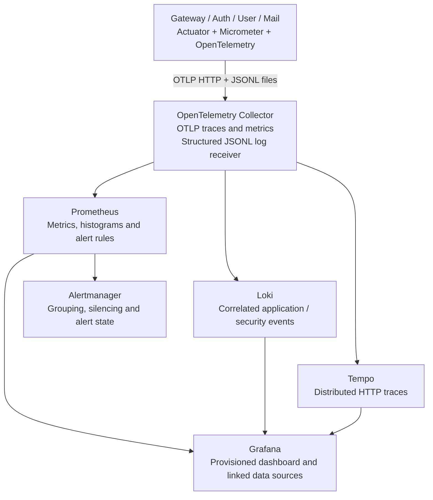

# P5 — Observability and monitoring

P5 adds Micrometer metrics, OpenTelemetry HTTP traces, a structured log stream, an OpenTelemetry Collector and a provisioned Prometheus/Loki/Tempo/Grafana/Alertmanager stack. Mail participates alongside Gateway, Auth and User. The existing UUID `X-Request-Id` remains the API correlation contract; OpenTelemetry trace/span IDs are separate fields.



## Start locally

Docker runs the observability stack; the four Java services continue running on the host. Put these settings in the existing ignored `.env` file before starting services:

```dotenv
OBSERVABILITY_ENABLED=true
GRAFANA_ADMIN_PASSWORD='<choose-a-local-password>'
OTEL_EXPORTER_OTLP_TRACES_ENDPOINT=http://127.0.0.1:4318/v1/traces
OTEL_EXPORTER_OTLP_METRICS_ENDPOINT=http://127.0.0.1:4318/v1/metrics
TRACING_SAMPLE_PROBABILITY=1.0
```

Then:

```bash
bash scripts/observability.sh up
bash run-services.sh
```

For IDE launches, make sure those environment settings reach each JVM, then restart the services. New Java dependencies require a rebuild. Shared `observability.yml` is imported by all four services. Remote metrics/traces export defaults to **disabled**, so ordinary development/tests work without the stack. Structured local telemetry is still written; exporters have short timeouts and run asynchronously, so Collector outages do not become login dependencies.

| Component | Loopback URL | Purpose |
| --- | --- | --- |
| Grafana | `http://127.0.0.1:3001` | User `admin`, configured password; folder **Hybrid Auth**, dashboard **Hybrid Auth - P5 Observability** |
| Collector | `http://127.0.0.1:4318` | `/v1/traces`, `/v1/metrics`, OTLP HTTP |
| Collector health | `http://127.0.0.1:13133` | Receiver process health |
| Prometheus | `http://127.0.0.1:9090` | Queries, targets and alert rules |
| Loki | `http://127.0.0.1:3100` | Log API |
| Tempo | `http://127.0.0.1:3200` | Trace search/API |
| Alertmanager | `http://127.0.0.1:9093` | Active alerts, grouping and silences |

Ports are configurable through the names in `compose.observability.yaml`. Every published port binds to `127.0.0.1`; backend services use a dedicated bridge network. Collector scrapes no application management port: Micrometer pushes metrics to Collector, and Prometheus scrapes Collector's internal `:8889` exporter. Actuator's existing public exposure remains limited to health/info; this change does not publish `/env`, `/configprops` or an unauthenticated application metrics endpoint.

`bash scripts/observability.sh down` stops this stack while keeping named data volumes. It does not stop PostgreSQL/Redis or Java services. All images are pinned to explicit release tags. Named volumes hold backend state; Collector persists file offsets and trace/log export queues.

## Metrics and dashboard

| Signal | Prometheus series / calculation |
| --- | --- |
| Login success rate | `rate(auth_login_attempts_total{outcome="success"}[5m]) / rate(all login attempts[5m])` |
| Login failure/error rate | Outcomes `failure` for non-2xx below 500; `error` for 5xx. Includes HTTP lockout/rate-limit denials. |
| Refresh reuse | `auth_refresh_reuse_detected_total` |
| Active sessions | `auth_active_sessions`; availability is `auth_active_sessions_available` |
| HTTP volume/errors | `http_server_requests_seconds_count`, grouped by `application` |
| HTTP p95/p99 | `histogram_quantile(0.95 or 0.99, sum by(application,le)(rate(http_server_requests_seconds_bucket[5m])))` |
| Redis failures | `auth_redis_connection_failures_total`; broader operation failures use `auth_redis_operation_failures_total{reason="connection"/"operation"}` |
| Security events | `security_events_total{event,outcome}` |
| JVM/process | Standard Actuator/Micrometer process, JVM and datasource meters |

Auth login metrics count the final HTTP result, so a rolled-back account transaction cannot appear as a successful login. Replay and Redis counters are initialized at zero, allowing Prometheus `increase()` to detect their first event. Redis connection failures include connection acquisition failures and command timeouts, measured at failed security-state operations rather than individual driver reconnect attempts.

Active-session snapshots run every 15 seconds against SQL. They exclude revoked/expired families and inactive, locked, deleted, unverified or stale-generation accounts. Multiple Auth instances observe the same database, so dashboards use **MAX**, not SUM. Failed SQL reads produce NaN plus availability 0 instead of pretending there are zero sessions. These gauges are eventually refreshed, not transaction-by-transaction accounting.

HTTP histograms use seconds, bounded 1 ms–30 s and explicit SLO boundaries; dashboards exclude Actuator requests. Metrics use bounded labels such as application, method, route template, status, event and outcome. User IDs, IPs, emails, key material, correlation IDs and raw request paths are not custom metric labels. `instance` and `job` are reserved for Collector/Prometheus; Micrometer does not add conflicting common tags.

## Traces, request IDs and logs

The two identifiers have different formats and roles:

- `X-Request-Id` / response `traceId`: the existing validated UUID, forwarded through Gateway and internal service clients; MDC key `correlationId`.
- `trace_id` / `span_id`: OpenTelemetry's 32/16 hex identifiers. W3C `traceparent` is propagated by Boot's instrumented client builders and Gateway observations. Micrometer may use MDC `traceId`/`spanId` without being overwritten by the UUID.

Internal `RestClient` and `WebClient` instances use Boot-configured builders, including Gateway identity checks and Auth profile calls. Reactor context propagation is automatic. Each MVC request's completion log is emitted while the server observation remains in scope. Existing UUID headers/envelopes and audit SQL correlation columns retain their contract.

Only controlled request-completion/failure and security events enter `logs/telemetry/<service>.<SERVER_PORT-or-default>.jsonl`. Each line contains timestamp, event, trace/span IDs when present, request UUID and safe status/outcome fields. When launching multiple instances, set a distinct `SERVER_PORT` environment value or a separate `TELEMETRY_LOG_PATH` for each process; this prevents shared rolling files. Request bodies, headers, credentials, proofs, raw emails/IPs, profile content and audit actors/details do not enter this telemetry stream. General framework debug logs are not tailed into Loki. The original security audit stream and durable SQL records remain separate.

Collector reads JSONL, extracts service name from the file path, sets native trace/span fields and forwards logs to Loki's OTLP endpoint. Grafana's Loki datasource links `trace_id` to Tempo; Tempo is linked back to Loki. To investigate a returned UUID:

```logql
{service_name="api-gateway"} | json | correlation_id="<X-Request-Id UUID>"
```

Open the trace link on a matching event, then inspect Gateway → Auth/User spans. Search the same UUID across services to include asynchronous outbox/Mail work. Outbox jobs preserve request correlation but do not persist the original W3C trace context; delayed work can have a new trace. Process restarts and log records outside a span also have no trace ID.

Collector removes full URLs/query strings, SQL statements and exception messages/stack traces from exported spans and exception events. The drill verifies this using a synthetic sensitive marker. Log IDs remain log fields, not Loki index labels. Local tracing samples 100% for diagnosis; configure `TRACING_SAMPLE_PROBABILITY` explicitly for production volume. Export is best-effort with bounded application queues; this is operational telemetry, not the durable audit ledger. Provision Collector/backend capacity and backups separately. The local stack uses filesystem storage with seven-day backend retention and seven-day/256 MB per-process telemetry file limits.

## Alerts

Prometheus evaluates `alerts-p5.yml` and sends alerts to Alertmanager. Grafana provides dashboard visibility, the Prometheus rule integration and an Alertmanager datasource. The default receiver is **local UI only**: no email, Slack or webhook is sent. Add the deployment's receiver credentials/routes in `alertmanager.yml` when notification delivery is required.

| Alert | Default trigger |
| --- | --- |
| HTTP errors | 5xx >5% for 2 min, at least 20 requests/5 min |
| Login failures/errors | >25% for 2 min, at least 20 attempts/5 min |
| Refresh replay | Any increase over 5 min |
| Redis failures | Any connection failure/timeout increase over 5 min |
| Latency | HTTP p99 >2 s for 5 min with at least 20 requests/5 min |
| Collector unavailable | Failed exporter scrape for 2 min |
| Service telemetry missing | Expected service uptime absent over 2 min, then a 2 min hold |
| SQL session snapshot unavailable | Availability 0 for 1 min |

Collector expires stale exported samples after 45 seconds; absence detection is measured after that expiry. Thresholds are regression defaults, not a production SLO. Rates need sufficient samples/traffic; no traffic is not a successful synthetic probe. A healthy Collector process alone does not prove backend ingestion—use the drill below for end-to-end evidence.

The earlier Python audit collector and its `prometheus.yml`/`alerts.yml` remain available independently; this stack uses `prometheus-p5.yml`/`alerts-p5.yml` and does not require that legacy endpoint.

## Verification

```bash
mvn clean verify
python3 scripts/verification/check_coverage.py
python3 scripts/verification/observability_drill.py
```

The P5 drill uses random loopback ports, generated identities/passwords and its own Compose project/volumes. It verifies real service traffic, JWT/scopes, Redis pause/timeouts, SQL session snapshots, Prometheus counters/histograms, correlated Loki logs, one Tempo trace containing Gateway/Auth/User, Grafana provisioning/datasource health, Prometheus rule syntax/unit tests and the replay alert. Its SMTP is a local sink. Containers/volumes are cleaned in `finally`; diagnostic files stay in a temporary directory and a safe success summary is written to ignored `reports/observability/result.json`.

CI runs the same drill in the `observability` job. Successful application unit tests alone do not establish backend ingestion. Official implementation references: [Spring Boot 3.5 tracing](https://docs.spring.io/spring-boot/3.5/reference/actuator/tracing.html), [Loki OTLP ingestion](https://grafana.com/docs/loki/latest/send-data/otel/), [Tempo configuration](https://grafana.com/docs/tempo/latest/configuration/) and [Prometheus alerting](https://prometheus.io/docs/alerting/latest/overview/).

### Recorded verification — 2026-10-30

The isolated clean reactor verification passed with **226 Java tests, zero failures/errors/skips**, and **93.72% aggregate line coverage**. The P5 full-service drill passed with real PostgreSQL/Redis, both Auth instances and Gateway/User/Mail JVMs: all required metric series and histogram buckets reached Prometheus, logs reached Loki with the request UUID, and Tempo returned a single trace containing `api-gateway`, `auth-service` and `user-service`. Grafana dashboard/datasource checks, refresh-replay alert activation and a real paused-Redis timeout counter also passed. Alert-rule unit tests passed through the pinned Prometheus `promtool`. All accounts and SMTP delivery were disposable test fixtures; no external email was sent.

The verification caught and fixed two ingestion issues: a duplicate Prometheus `instance` label and Gateway's previously missing `spring.application.name`. It also corrected Tempo 3's retention configuration and Docker Desktop port publishing. A separate `--config-only` mode validates backend health, provisioning, every dashboard PromQL/LogQL expression and alert-rule unit tests without starting Java services.

Separate configuration-only verification passed every dashboard PromQL/LogQL query (including Loki All selection), alert-rule unit tests and an actual Collector-to-Tempo privacy check proving a synthetic URL/exception marker was removed before storage. All temporary stack resources were removed afterward.
